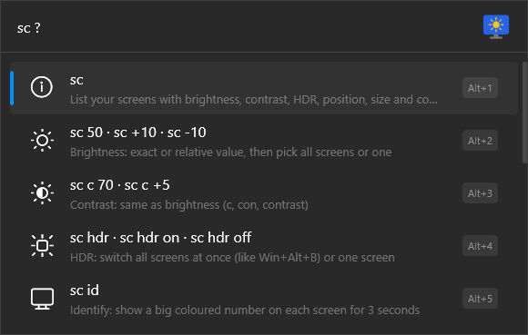
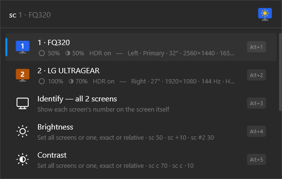
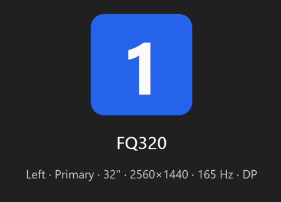
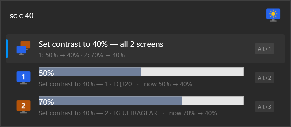
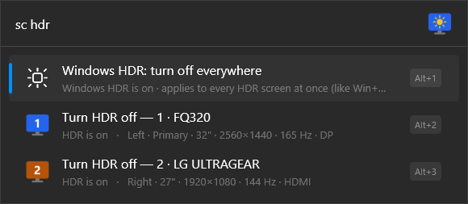
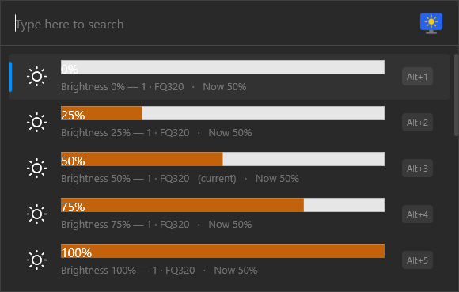
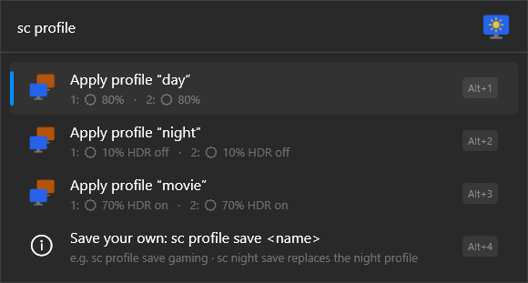

<h1 align="center">
  <br>
  ScreenControl for Flow Launcher
</h1>

<p align="center">
  Brightness, contrast and HDR for every screen, from your keyboard.<br>
  Knows which screen is which, and shows it on the screen itself.
</p>

<p align="center"></p>

## Features

- **Brightness and contrast** for each screen or all at once, exact (`sc 50`) or relative (`sc +10`).
- **HDR**: the Windows HDR switch for every screen at once, or one screen at a time.
- **Which screen is which**: screens are numbered left to right, each with its own colour,
  and `sc id` shows the number on every screen.
- **Quick actions** with `Shift+Enter`: presets, HDR, identify, without typing.
- **Profiles** (`sc night`, `sc movie`, your own) and **nicknames** (`sc name #2 Gaming`).
- **Fast and sturdy**: instant results, nothing to install, restarts itself if anything goes wrong.

---

## Installation

### Requirements

- Windows 10 or 11 with [Flow Launcher](https://www.flowlauncher.com/) (tested with Flow 2.1.3).
- Flow's default Python setup is enough: nothing else to install.
- External monitors need **DDC/CI** turned on in their own on-screen menu (it usually is).
  Without it, HDR and identification still work; brightness and contrast don't.

### From Flow Launcher (plugin store)

Open Flow and type:

```
pm install ScreenControl
```

> Available once the plugin is published in the Flow plugin store.

### From a release

Install a specific release straight from Flow ([all releases](https://github.com/aalbertinib/flow-launcher-screen-control/releases)):

```
pm install https://github.com/aalbertinib/flow-launcher-screen-control/releases/download/v1.1.0/Flow.Launcher.Plugin.ScreenControl.zip
```

Or by hand: extract the release zip into `%APPDATA%\FlowLauncher\Plugins\ScreenControl`
and restart Flow.

### From the source code

Needs Python 3.11+ and Git. From the project folder:

```bash
python build_plugin.py install
```

This bundles the dependencies, installs the plugin into Flow, sets up the
`Ctrl+Alt+Shift+C` shortcut and restarts Flow. Add `--no-restart` to restart Flow
yourself, or `--hotkey "Ctrl+Alt+F9"` for another shortcut (`--hotkey none` for none).

### After installing

- Type **`sc`** in Flow, or press **`Ctrl+Alt+Shift+C`** (source install) to open it directly.
  To add or change that shortcut: Flow Settings → Hotkey → Custom Query Hotkeys, with `sc ` as the query.
- The keyword can be changed in Flow Settings → Plugins → ScreenControl.
- To remove the plugin: `pm uninstall ScreenControl`.

---

## Usage guide

Everything starts with `sc`. Words can be typed in any order, and `sc ?` lists every
command with an example. A half-typed command suggests how to finish it (`sc nig` → `sc night`). Picking a row with `Enter` runs it and keeps Flow open, so you
can adjust again straight away.

<p align="center"></p>

### Your screens

`sc` lists each screen with its brightness, contrast and HDR state, followed by shortcuts
to every command.

<p align="center"></p>

- Screens are **numbered left to right** and each number has a **colour**, the same in Flow
  and on the screen.
- **`sc id`** shows a big number on every screen for 3 seconds. Picking a screen in the
  list also flashes its number on it.
- **`sc #2`** opens everything about screen 2: brightness, contrast, HDR and identify.
- Hover a screen for a tooltip; `Ctrl+C` copies its details (model, serial, connection).

<p align="center"></p>

### Brightness and contrast

| Type | Result |
| --- | --- |
| `sc 50` | Brightness 50%: pick "all screens" or one screen |
| `sc +10` / `sc -10` | Brightness up / down from the current value |
| `sc c 70` | Contrast 70% (`c`, `con`, `contrast`) |
| `sc c +5` | Contrast up by 5 |
| `sc b` / `sc c` | Current brightness / contrast of each screen, as bars |
| `sc #2 30` | Brightness 30% on screen 2 only |

Values go from 0 to 100; `50%` works too. Each row shows the current value in its bar,
so screens are easy to compare before picking one.

<p align="center"></p>

### HDR

| Type | Result |
| --- | --- |
| `sc hdr` | **Windows HDR** on/off for every HDR screen at once (like `Win+Alt+B`), then one row per screen |
| `sc hdr on` / `sc hdr off` | Turn HDR on / off, all screens or one |
| `sc #1 hdr` | Toggle HDR on screen 1 only |

The screens flicker for a moment while Windows switches mode. Screens without HDR are
listed as such.

<p align="center"></p>

### Pick a screen

Add any of these to a command to aim it at one screen:

- its number: `#2`
- its name, brand or nickname: `lg`, `fq320`, `gaming`
- its position: `left`, `right`, `top`, `bottom`, `middle`, `primary`
- its connection: `hdmi`, `dp`, `internal`

For example `sc left 40`, `sc lg c 60`, `sc hdmi hdr off`.

### Quick actions (`Shift+Enter`)

On a screen, or on an "all screens" row, press `Shift+Enter` (or your Flow
context-menu key) for presets without typing: brightness and contrast at
0 / 25 / 50 / 75 / 100% (the current one is marked), HDR on/off, and identify.

<p align="center"></p>

### Profiles

A profile sets brightness, contrast and HDR on every screen in one go.

| Type | Result |
| --- | --- |
| `sc day` | Brightness 80% on all screens |
| `sc night` | Brightness 10%, HDR off |
| `sc movie` | Brightness 70%, HDR on |
| `sc profile` | All profiles, with what each one sets on each screen |
| `sc night save` | Replace "night" with your current settings |
| `sc profile save gaming` | Create your own profile from the current settings |
| `sc profile reset night` / `sc profile delete gaming` | Restore a default / delete your own |

Saved profiles remember each screen separately.

<p align="center"></p>

### Nicknames

| Type | Result |
| --- | --- |
| `sc name #2 Gaming` | Screen 2 becomes "2 · Gaming (LG ULTRAGEAR)" everywhere |
| `sc name #2` | Offers to remove the nickname |
| `sc name` | Lists screens to rename |

A nickname follows the monitor itself (by model and serial number), even on another port.
Nicknames can also be used to pick a screen: `sc gaming 40`.

### Something wrong?

- **`sc reset`** (also `repair`, `fix`) restarts the monitor communication and clears caches.
  Error rows offer it on `Enter` too.
- **"Brightness unavailable"**: enable DDC/CI in the monitor's on-screen menu; some docks,
  KVMs and adapters block it.
- **"The monitor answered with corrupted data"**: the monitor is stuck; turn it off and on
  with its power button.
- If the plugin itself crashes or hangs, it restarts on its own. After repeated failures it
  shows "Press Enter to restart".
- Logs: `screen_control.log` in `%APPDATA%\FlowLauncher\Plugins\ScreenControl`. Create an
  empty `debug.flag` file there for detailed logs.

### Good to know

- Values are re-read in the background every 30 seconds, so the list opens instantly. After
  changing a setting with the monitor's own buttons, the next keystroke shows the new value.
- Nicknames and profiles are stored in
  `%APPDATA%\FlowLauncher\Settings\Plugins\ScreenControl\screen_control.json` and survive updates.
- Laptop built-in screens use Windows' brightness control (no contrast). This path has not
  been tested on real hardware yet.
- The plugin never uses the network.

---

## Credits

Inspired by [ScreenBrightness](https://github.com/cibere/Flow.Launcher.Plugin.ScreenBrightness)
by cibere, the Flow Launcher plugin that first brought monitor brightness to Flow.
Built with [flogin](https://github.com/cibere/flogin), cibere's Python framework for Flow plugins.

## License

[MIT](LICENSE). Bundled third-party code: [THIRD_PARTY_NOTICES.md](THIRD_PARTY_NOTICES.md).

## Development

```bash
python build_plugin.py install-lib
```

```bash
python -m unittest discover -s tests -t .
```

- `tools/probe.py`: what Windows reports for each screen (read-only).
- `tools/rpc_harness.py`: runs the plugin exactly like Flow does
  (`--run "QUERY" N` presses Enter on result N, which **does** change settings).
- `tools/make_icons.ps1`: regenerates the icons.
- `tools/record_demo.py`: re-records `docs/demo.gif` and the screenshots in `docs/images` (see [docs/PUBLISHING.md](docs/PUBLISHING.md)).
- Releasing and publishing to the Flow plugin store: [docs/PUBLISHING.md](docs/PUBLISHING.md).
